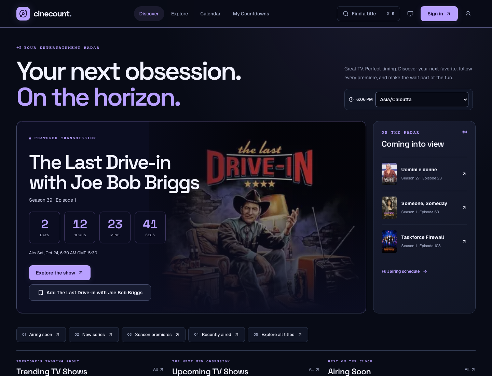
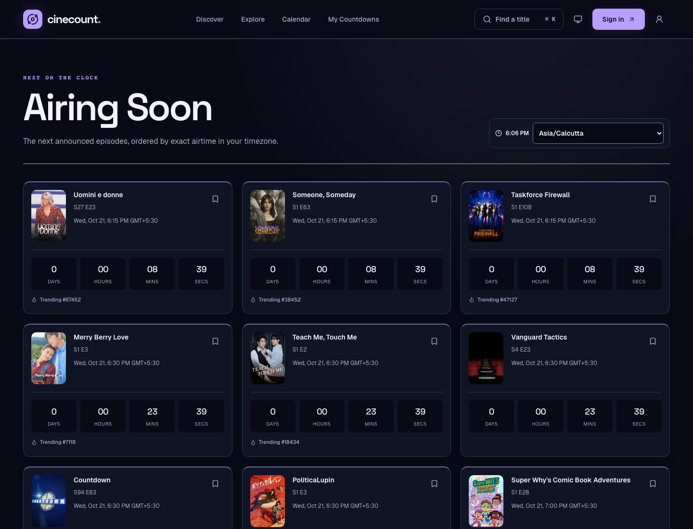
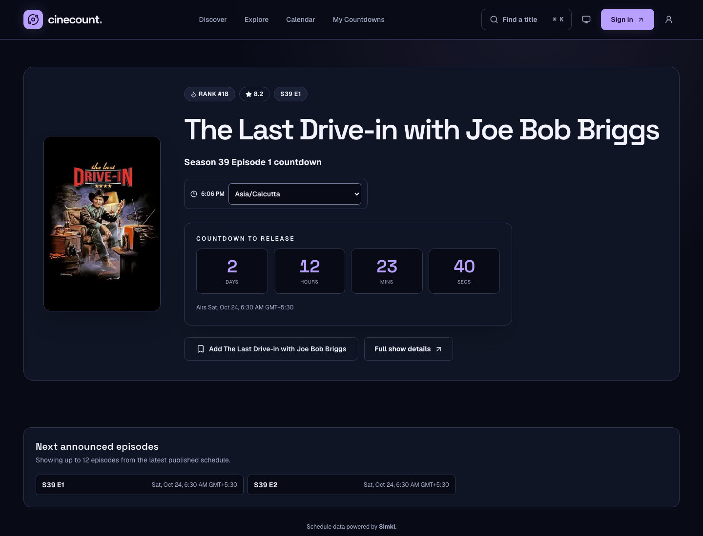
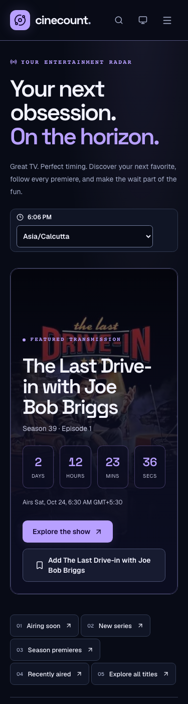
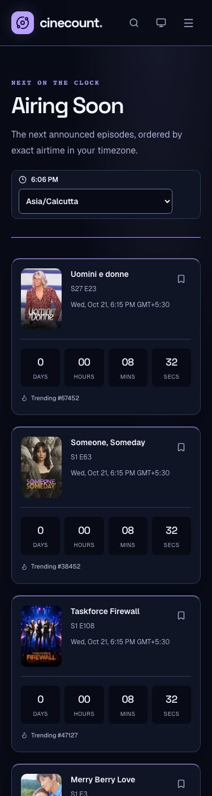

# Orbit — futuristic design

Midnight blue surfaces, violet accents, Space Grotesk headings, instrument-style countdowns, a live episode rail, and crisp outlined cards.

This is one of two independent design alternatives branched from `main`. Shared tokens and components carry the visual language through schedules, discovery, title details, calendar, saved collections, profile, search, authentication, loading, empty, and error states. Both light and dark themes remain available and respect existing saved preferences.

## Screenshots

These are browser captures of the implemented application, using the live Simkl schedule. No episode data was fabricated. Desktop captures use 1440 × 1100; mobile captures use 375 × 1400. The featured title, airtimes, and countdowns will change as the source updates.








## Reproduce

Start the application using the README's local environment setup, then run:

```sh
npm run dev -- --port 3101
# In another terminal:
DESIGN_URL=http://localhost:3101 DESIGN_THEME=dark node scripts/capture-design.mjs
```

Install Chromium with `npx playwright install chromium` if needed. The capture script waits for fonts, visible images, tracker hydration, and route content; it checks page errors and horizontal overflow. It hides only the Next.js development overlay.

## Validation

- `npm run lint`
- `npm run build`
- `NODE_OPTIONS=--no-experimental-webstorage npm test` — 43 files, 280 tests passed. The flag avoids Node 26's native localStorage conflict with jsdom.
- `PLAYWRIGHT_PORT=3101 npm run test:e2e -- e2e/core-flows.spec.ts --workers=2` — all 13 scenarios passed (including focused retries where needed).
- Browser coverage includes mobile navigation, discovery filters, saving, episode detail navigation, auth redirects, keyboard focus in search, both themes, and reduced motion.

Browser acceptance checks use the repository's documented `TMDB_API_READ_ACCESS_TOKEN=` setup. TMDB requests timed out in the live environment; schedule screenshots use Simkl independently. No API, authentication, storage, or schedule-domain behavior was changed.
